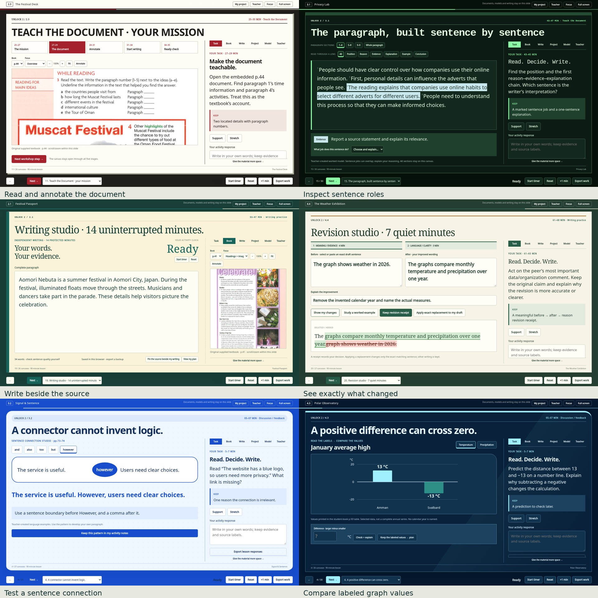

# Unlock Units 2–4 · Integrated Writing Studio

[**Download the updated twelve-lesson course**](./Unlock_Units_2-4_12_Lessons.zip?raw=true) · [Twelve designs](./Design_Preview.jpg) · [Inside the interactive slides](./Interaction_Preview.jpg)

Download and extract the ZIP on your computer. Open **index.html** inside the extracted **Unlock_Units_2-4** folder, then choose a lesson. These are standalone HTML presentations for a modern browser, with JavaScript built in. Present them in the browser; native PowerPoint does not execute their JavaScript.

Every activity now shares its canvas with **Task, Book, Write, Project, Model and Teacher** material. Textbook pages, writing fields, full worked examples, rubrics, teacher support and the optional local video player stay inside the current slide. Widen the material area or use Focus for projection.

The updated course includes:

- **12 individual 90-minute lessons**, preserving all **384 timed activities**. Related steps share 318 core canvases; 64 optional extensions sit outside the schedules.
- **12 different visual designs**, with embedded typography, authentic source photographs, varied activity layouts and motion with reduced-motion support.
- **Six Teach the Document assignments.** Lessons 1 and 3 of each unit have a ten-minute mission canvas with five stages: task, document, annotation, written start and checklist. Lessons 2 and 4 have a ten-minute teaching canvas with speaker/listener prompts and phase timers.
- **More writing interactions:** document annotations saved to the plan, credited evidence selection, source-to-paragraph demonstrations, sentence-role inspection, before/after revision differences and receipts, sentence ordering, connector choices, fictional privacy/time simulations and source-backed graph comparisons.
- **12 lesson worksheets and six TTD workshop sheets**, complete models and rubrics, the teacher guide and course map. These are optional paper resources; the presentation contains its classroom material.
- **Compatible saved writing.** Earlier paired Writing Studio v2 JSON files still import. Export editable work before moving to the next lesson or another device.

| Lesson | Design | Teach the Document |
|---|---|---|
| 2.1 | Festival Passport | #1 launch |
| 2.2 | Night Parade | #1 complete and teach |
| 2.3 | The Festival Desk | #2 launch |
| 2.4 | Culture Zine | #2 complete and teach |
| 3.1 | Privacy Lab | #3 launch |
| 3.2 | Signal & Sentence | #3 complete and teach |
| 3.3 | The Opinion Arena | #4 launch |
| 3.4 | The Opinion Press | #4 complete and teach |
| 4.1 | Weather Fieldbook | #5 launch |
| 4.2 | Desert Data Atlas | #5 complete and teach |
| 4.3 | Polar Observatory | #6 launch |
| 4.4 | The Weather Exhibition | #6 complete and teach |

Independent writing lasts 14 minutes in odd lessons and 12 minutes in even lessons, with seven minutes of revision in both. Schedules run continuously from 0 to 90 minutes. The integrated canvas combines related stages without removing the planned activities.

Sources, models, fonts and scripts are embedded. Publisher videos are separate; the Teacher tab plays a video already on your computer inside the canvas, and complete offline reading alternatives remain available. Student writing and local video are not uploaded by the files.

The original Unit 2 Lesson 1 information is retained in its Teacher tab, and the complete textbook pages remain embedded across their units.

See the [teacher guide](./Teacher_Guide.md), [revision notes](./Revision_Notes.md), [course map](./Course_Map.csv) and [validation summary](./QA_Summary.txt). All twelve presentations passed the interaction checks, all core canvases were checked at three projector sizes, and all eighteen paper worksheets were checked for printing. See the validation summary for the cloud browser's local-file test limitation.

This folder supplies downloadable files; it does not publish a website.

