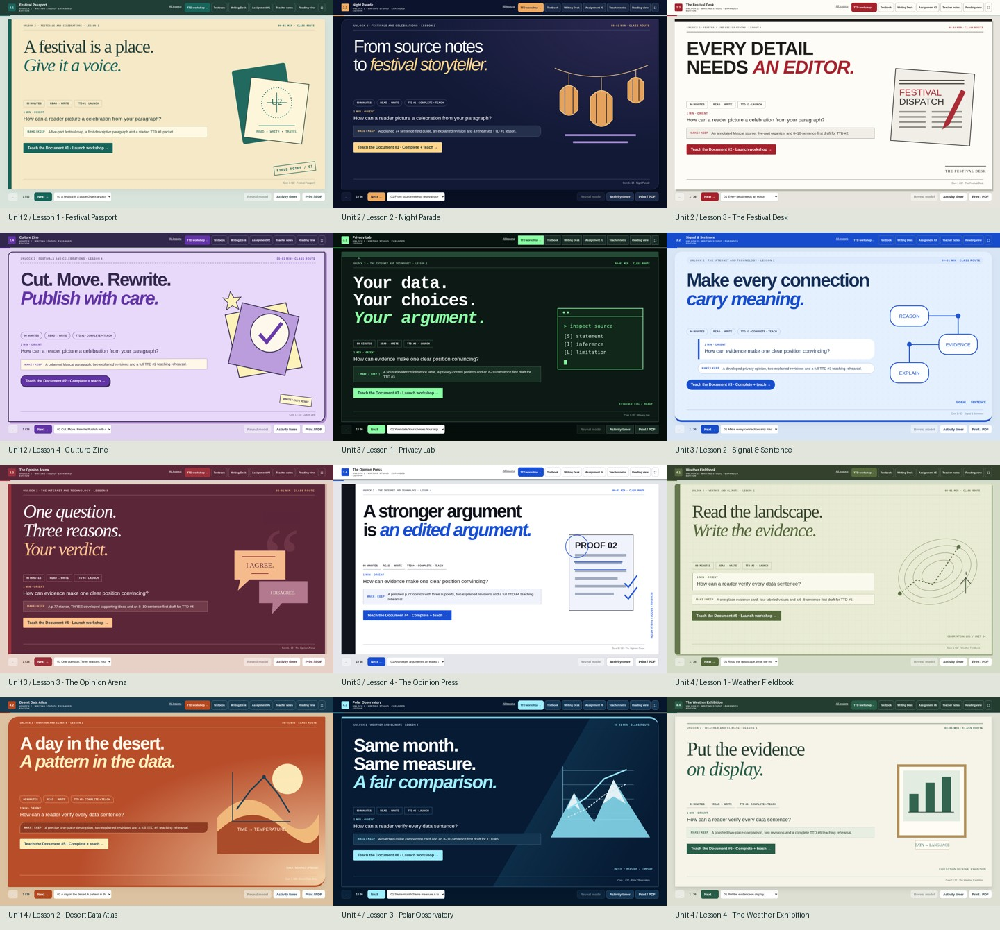

# Unlock Units 2–4 · Expanded edition

[**Download all 12 presentations and teaching materials**](./Unlock_Units_2-4_12_Lessons.zip?raw=true) · [Preview all twelve designs](./Design_Preview.jpg)

Extract the ZIP on your computer, then open **index.html** in the extracted **Unlock_Units_2-4** folder. Choose a lesson from the library. Each presentation works offline in a browser.

The expanded course includes:

- **12 individual 90-minute presentations**, with 32 timed core slides each: 384 core slides, plus 64 optional extensions.
- **12 different visual designs**, with distinct typography, illustrations, page compositions and activity styling.
- **Six Teach the Document assignments.** Lessons 1 and 3 of each unit include a five-screen, ten-minute launch with a document, annotation, written start and requirements. Lessons 2 and 4 include ten minutes for paired teaching and feedback.
- **12 printable lesson worksheets and six TTD workshop sheets**, plus the teacher guide, models, rubrics and course map.
- A saved lesson response pad, the paired Writing Desk, interactive reasoning tasks, sentence-role reveals and printable writing. Earlier Writing Desk JSON files remain compatible.

| Lesson | Design | Teach the Document |
|---|---|---|
| 2.1 | Festival Passport | #1 launch |
| 2.2 | Night Parade | #1 complete and teach |
| 2.3 | The Festival Desk | #2 launch |
| 2.4 | Culture Zine | #2 complete and teach |
| 3.1 | Privacy Lab | #3 launch |
| 3.2 | Signal & Sentence | #3 complete and teach |
| 3.3 | The Opinion Arena | #4 launch |
| 3.4 | The Opinion Press | #4 complete and teach |
| 4.1 | Weather Fieldbook | #5 launch |
| 4.2 | Desert Data Atlas | #5 complete and teach |
| 4.3 | Polar Observatory | #6 launch |
| 4.4 | The Weather Exhibition | #6 complete and teach |

The independent writing studio lasts 14 minutes in odd lessons and 12 minutes in even lessons, with guided writing, planning, feedback and revision around it. Timelines run continuously from 0 to 90 minutes. Optional slides sit outside those 90 minutes.

Read the [teacher guide](./Teacher_Guide.md), [revision notes](./Revision_Notes.md), [course map](./Course_Map.csv), or [validation summary](./QA_Summary.txt) before downloading if useful. The original Unit 2 Lesson 1 information and complete embedded textbook reference pages remain in the presentations.

All core slides were checked at 1440 × 900, 1366 × 768 and 1280 × 720, with mobile and interaction checks. All 448 slides were checked through print-to-PDF. Long typed responses and paragraphs were also checked for complete printing. Licensed publisher videos are separate; labeled reading alternatives are included.

This folder supplies downloadable files. It does not publish a website.

