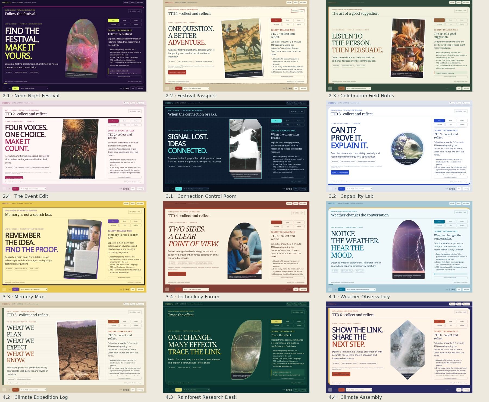

# Unlock 2 · Listening & Speaking · Units 2–4

**Twelve individual 90-minute HTML presentations**, with speaking as the main classroom output, 258 timed activity canvases, 12 distinct designs and six Teach the Document assignments.

## Download and open

1. **[Download the complete course ZIP](Unlock_LS_Units_2-4_12_Lessons.zip?raw=true)** (about 19 MB).
2. Extract the ZIP.
3. Open **index.html** in your browser, then choose a lesson.

The index is a local lesson library; GitHub displays its source rather than running it as a teaching website. Each lesson below can also be downloaded individually and opened by itself. If GitHub displays code, choose **Download raw file**.

## Individual presentations

| Unit / lesson | Lesson | Download standalone HTML | TTD cycle |
|---|---|---|---|
| 2.1 | Follow the festival. | [Neon Night Festival](Unit2_Listening_Speaking_Lesson1.html?raw=true) | TTD #1 launch |
| 2.2 | Ask better. Discover more. | [Festival Passport](Unit2_Listening_Speaking_Lesson2.html?raw=true) | TTD #1 collect / transfer |
| 2.3 | The art of a good suggestion. | [Celebration Field Notes](Unit2_Listening_Speaking_Lesson3.html?raw=true) | TTD #2 launch |
| 2.4 | Make the case. Make the choice. | [The Event Edit](Unit2_Listening_Speaking_Lesson4.html?raw=true) | TTD #2 collect / transfer |
| 3.1 | When the connection breaks. | [Connection Control Room](Unit3_Listening_Speaking_Lesson1.html?raw=true) | TTD #3 launch |
| 3.2 | What can it really do? | [Capability Lab](Unit3_Listening_Speaking_Lesson2.html?raw=true) | TTD #3 collect / transfer |
| 3.3 | Memory is not a search box. | [Memory Map](Unit3_Listening_Speaking_Lesson3.html?raw=true) | TTD #4 launch |
| 3.4 | A report worth listening to. | [Technology Forum](Unit3_Listening_Speaking_Lesson4.html?raw=true) | TTD #4 collect / transfer |
| 4.1 | Weather changes the conversation. | [Weather Observatory](Unit4_Listening_Speaking_Lesson1.html?raw=true) | TTD #5 launch |
| 4.2 | Plans, predictions and evidence. | [Climate Expedition Log](Unit4_Listening_Speaking_Lesson2.html?raw=true) | TTD #5 collect / transfer |
| 4.3 | Trace the effect. | [Rainforest Research Desk](Unit4_Listening_Speaking_Lesson3.html?raw=true) | TTD #6 launch |
| 4.4 | Make the climate story clear. | [Climate Assembly](Unit4_Listening_Speaking_Lesson4.html?raw=true) | TTD #6 collect / transfer |

## Integrated tools

Task, Book, Listen, Language, TTD and Teacher all operate inside the current slide. Textbook pages enlarge there, too. The presentations include original teacher-read listening inputs, hidden transcripts, local audio/video playback, short cue notes, private role cards, speaking timers, optional local recording, source-based decisions, feedback and replay. Cue-note exports transfer between the two lessons in each pair.

TTD launches in Lessons 1 and 3 of every unit and is collected at the next lesson's start. Each final recording is 3–5 minutes in English, teaching a genuine visible document from short cues. Worked sources, short model extracts, two comprehension questions, planning tools and checklists are included. Actual calendar dates and the submission route are announced by the instructor.

## Teacher and reference material

- [Complete teacher guide: every 90-minute route, facilitation and original listening key](Teacher_Guide.md)
- [Course map](Course_Map.csv)
- [Source alignment](Source_Alignment.md)
- [How to use](README.txt)
- [Validation summary](QA_Summary.txt)
- [Detailed validation report](Validation_Report.json)
- [Archive SHA-256](Package_SHA256.txt)

Publisher audio is not bundled; each lesson has a complete original teacher-read alternative and separate practice questions/key. The publisher route is identified for teachers who have licensed recordings. These are JavaScript HTML browser presentations, not native PowerPoint files. Classroom sources, fonts, images and scripts are embedded. Optional microphone/storage behavior depends on the user's browser; recordings must be downloaded before closing the page.

All 12 lessons were checked at 1440×900, 1366×768, 1280×720 and 390px width. Same-slide materials, TTDs, private role-card printing, paired saving/import/export, timers, local media and generated-stream recording passed. No checked JavaScript errors, external classroom requests or horizontal overflow remained. The separate Reading & Writing course is unchanged.
